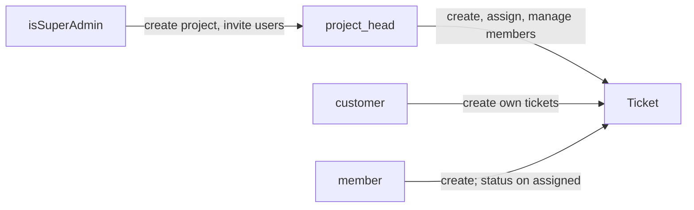
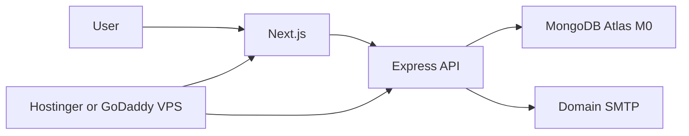

# Ticketing Software — Revised Architecture Plan

> Version 1.2 · 31 Oct 2026 · Status: Ready for implementation
> Supersedes: `Architecture/Plan/plan.md` (v1.0) and revised_plan v1.1
> Source: `Ticketing-software.drawio`

---

## Changelog

### From v1.0 (closed product decisions)

- **Platform vs project roles.** `isSuperAdmin` is a user flag. Project roles are only `project_head`, `member`, `customer`. There is no per-project `admin`. The word “Guest” is dropped.
- **Ticket workflow.** Tickets use their own status set, not project statuses. Transitions are in section 6.3.
- **Customer visibility.** Default: tickets they created. Optional per-project `customerSeesAllTickets`.
- **Tenancy.** v1 is a **single organisation**. No `orgId`. Billing is out of v1.
- **IDs.** Drop `uid`. Project `key` is unique. Ticket display IDs are `KEY-0001` (4-digit pad).
- **Project status typo.** `scraped` → `scrapped`.
- **Members can create tickets.** Super Admin can also be a Member in a project if they need to be assigned work.

### From v1.1 (this revision)

- **Stack restored** to v1.0: Next.js, Expo (later), Node + Express (or NestJS), **MongoDB + Mongoose**, Zod, TanStack Query, JWT, bcrypt/argon2, Turborepo/Nx + pnpm.
- **Comments, attachments, activity** are **deferred** (post-v1). Tickets in v1 are create / assign / status only.
- **Budget.** One paid domain + one VPS at GoDaddy or Hostinger. MongoDB Atlas M0 (free). No Vercel, Render, R2, Resend, or Sentry.
- **SMTP stays.** Invite, assignment, and status emails via **Nodemailer + the domain mailbox** (`no-reply@yourdomain.com`). Not a paid mail API.

---

## 1. Overview

A multi-project ticketing platform for **one organisation**, built as a small bootstrapped product. A Super Admin creates projects, invites users, and assigns each user a **role within that project**. Tickets (Task / Bug / New Request) are raised inside a project and assigned to **Members**, who work on them.

### Module hierarchy

1. **Project Creation** (main module): title, description, duration, status, allowed ticket types
2. **User Management**: users, plus their role in each project
3. **Ticket Management**: tickets scoped to a project (create, assign, status, priority)
4. **Dashboards & Insights**: multi-project dashboard and per-project insights
5. **Notifications**: transactional email over domain SMTP (invite, assignment, status)

Billing is **out of scope for v1**. Comments, attachments, and ticket activity history are **deferred** (section 6.4).

### Identity model

| Kind | What it is |
|---|---|
| **Super Admin** | User flag `isSuperAdmin`. Platform-only: create/edit/delete projects, invite and disable users, add people to any project, see every project. Treated as Project Head for ticket actions in every project. Cannot be assigned a ticket unless they also hold the **Member** role in that project. |
| **Project Head** | Per-project role. Owns the project operationally: members, tickets, assignment, status, insights. |
| **Member** | Per-project role. Creates tickets, is the only assignable role, updates status on tickets assigned to them. |
| **Customer** | Per-project role. Creates tickets and tracks tickets they can see. Never assigned work. |

One user can be Project Head in Project A and Customer in Project B. A user has **exactly one role per project**.



---

## 2. Tech Stack

Same stack as `plan.md`. Default implementation choice for a small team is in **bold**.

| Layer | Technology | Notes |
|---|---|---|
| Web | React + **Next.js** (App Router), TypeScript | Admin panel and all role views. UI only — no business logic in Next Route Handlers. |
| Mobile | **React Native** (Expo), TypeScript | Post-v1. Same API and shared packages. |
| Backend | **Node.js + Express** (or NestJS), TypeScript | Single source of business logic. Express is the bootstrap default. |
| Database | **MongoDB + Mongoose** | users, projects, projectMembers, tickets, tokens |
| Email | **Nodemailer** + domain SMTP | GoDaddy/Hostinger mailbox, e.g. `no-reply@yourdomain.com` |
| Validation | Zod (shared) | Same schemas on client and server |
| Data fetching | TanStack Query + shared API client | Web and (later) mobile |
| Auth | JWT access + refresh, bcrypt/argon2 | httpOnly cookie (web); SecureStore (mobile, later) |
| Monorepo | Turborepo / Nx + **pnpm** workspaces | Shared types, enums, permissions. Turborepo is the lighter default. |
| Logs | pino | stdout on the VPS. No Sentry in v1. |

No object storage in v1 (attachments are deferred). Local mail testing: Mailpit in docker-compose.

---

## 3. High-Level Architecture

```
┌────────────────────┐    ┌──────────────────────┐
│ Web: Next.js       │    │ App: React Native     │
│ Super Admin / PH / │    │ Post-v1               │
│ Member / Customer  │    │ Member / Customer / PH│
└─────────┬──────────┘    └──────────┬───────────┘
          │      HTTPS · REST · JWT   │
          └────────────┬──────────────┘
         ┌─────────────▼──────────────────────────┐
         │  Node.js API (Express, modular monolith)│
         │  authenticate → projectRole → authorize │
         │  → validate → controller → service      │
         │                                         │
         │  Auth │ Projects │ Users │ Memberships  │
         │  Tickets │ Insights │ Notifications     │
         └──────┬──────────────┬───────────────────┘
                │              │
         ┌──────▼──────┐ ┌─────▼──────────────┐
         │ MongoDB     │ │ Domain SMTP        │
         │ Atlas M0    │ │ Nodemailer         │
         └─────────────┘ │ no-reply@domain    │
                         └────────────────────┘
```

One small **VPS** (Hostinger KVM preferred; GoDaddy VPS is fine) runs both Next.js (standalone) and the API behind Caddy or nginx + Let’s Encrypt.

### Principles

- **One backend for all clients.** All business rules live in the Node API. Next.js is the web UI only.
- **Modular monolith.** One deployable API, modules talk only through services (`eslint-plugin-boundaries`).
- **Project-scoped security.** Every project request resolves the caller's role *in that project*. Super Admin is treated as Project Head for authorization even without a membership row.
- **Shared contracts.** Types, enums, Zod schemas, permission matrix, and error codes live in `packages/shared`.
- **Resource rules in the service.** `can(role, perm)` is not enough. “Own ticket”, “assigned to me”, and `customerSeesAllTickets` are enforced in the service layer.
- **Low cost.** One domain, one VPS, Atlas free tier, mailbox SMTP that comes with the domain. No extra PaaS or mail API.

---

## 4. Repository Structure

```
ticketing/
├── apps/
│   ├── web/                Next.js (App Router)
│   ├── mobile/             React Native (Expo) — scaffold in v1, ship later
│   └── api/                Node.js + Express + Mongoose
│       └── src/
│           ├── modules/
│           │   ├── auth/
│           │   ├── projects/
│           │   ├── users/
│           │   ├── memberships/
│           │   ├── tickets/
│           │   ├── insights/
│           │   └── notifications/  events → Nodemailer (in-process)
│           ├── middleware/         authenticate · projectRole · authorize · validate
│           ├── models/             User · Project · ProjectMember · Ticket · tokens
│           ├── events/             in-process event bus
│           └── config/
├── packages/
│   ├── shared/             enums, TS types, Zod schemas, permissions.ts, errors.ts
│   └── api-client/         typed HTTP client for web + mobile
├── docker-compose.yml      mongo, api, web, mailpit (local SMTP)
└── .github/workflows/      lint, type-check, test on PR
```

---

## 5. Roles & Permissions

### Permission matrix (coarse)

| Action | Super Admin | Project Head | Customer | Member |
|---|:-:|:-:|:-:|:-:|
| Create / edit / delete / restore project | ✅ | ❌ | ❌ | ❌ |
| Invite / disable users (platform) | ✅ | ❌ | ❌ | ❌ |
| Add users to project and set role | ✅ | ✅ (own project) | ❌ | ❌ |
| Create ticket | ✅ | ✅ | ✅ | ✅ |
| Assign ticket to a Member | ✅ | ✅ | ❌ | ❌ |
| Can be assigned a ticket | only if also Member in that project | ❌ | ❌ | ✅ |
| Edit ticket details / priority / due date | ✅ | ✅ | ✅ (own, not closed) | ❌ |
| Update ticket status | ✅ | ✅ | ❌ | ✅ (assigned) |
| View tickets | all | all in project | own, or all if project setting | all in project |
| View project insights | ✅ | ✅ | own-ticket subset | ✅ |
| User dashboard | ✅ | ❌ | ❌ | ❌ |

### Shared permission matrix

```ts
// packages/shared/permissions.ts
export const PROJECT_ROLES = ['project_head', 'customer', 'member'] as const;
export type ProjectRole = typeof PROJECT_ROLES[number];

export const PERMISSIONS = {
  'project:manage':    ['super_admin'],
  'user:manage':       ['super_admin'],
  'member:manage':     ['super_admin', 'project_head'],
  'ticket:create':     ['super_admin', 'project_head', 'customer', 'member'],
  'ticket:assign':     ['super_admin', 'project_head'],
  'ticket:edit':       ['super_admin', 'project_head', 'customer'],
  'ticket:status':     ['super_admin', 'project_head', 'member'],
  'ticket:view':       ['super_admin', 'project_head', 'customer', 'member'],
  'insights:view':     ['super_admin', 'project_head', 'customer', 'member'],
} as const;

export const ASSIGNABLE_ROLES: ProjectRole[] = ['member'];

export const can = (
  actor: 'super_admin' | ProjectRole,
  perm: keyof typeof PERMISSIONS,
) => (PERMISSIONS[perm] as readonly string[]).includes(actor);
```

`can()` hides buttons in the UI. The API still runs **resource rules** in section 9.

---

## 6. Core Modules

### 6.1 Project Creation (main module)

| Field | Details |
|---|---|
| `_id` | Mongo ObjectId |
| `key` | Short unique prefix, uppercase, 2–8 chars (e.g. `PAY`, `WEB`). Used in ticket IDs. Immutable after creation. |
| Title, Description | Title required |
| Duration | `startDate`, `endDate` (optional end). Timezone: UTC dates. |
| Status | `todo` · `ongoing` · `completed` · `on_hold` · `scrapped` |
| `ticketTypes` | Any of `task`, `bug`, `new_request` |
| `customerSeesAllTickets` | Boolean, default `false` |
| `ticketSeq` | Integer counter, default 0 |
| Actions | Edit, soft-delete, restore |

**Read-only projects.** When status is `completed` or `scrapped`, or `endDate` is in the past, the project is **read-only**: no new tickets, no assignment, no status changes. Super Admin can reopen by changing status / end date.

**Narrowing `ticketTypes`.** Allowed only if no open tickets of the removed type exist. Otherwise 409 `TICKET_TYPE_IN_USE`.

### 6.2 User Management

- Super Admin invites users by email (domain SMTP). Invite TTL: **72 hours**. User sets their own password via `/auth/invite/accept`.
- Re-invite allowed if status is `invited` or invite expired; previous token is revoked.
- User list (paginated): name, email, status, **projects and role in each**, created at.
- Inside a project, Super Admin or that project's Project Head adds an existing user and sets their role.
- Disabling a user (`status: disabled`) revokes refresh tokens immediately. They cannot log in. Open tickets they are assigned stay assigned until someone reassigns (do not auto-unassign).
- Changing role away from `member` while they have **open** assigned tickets: **block** (409 `MEMBER_HAS_OPEN_TICKETS`) unless the caller also reassigns or unassigns in the same request.
- Removing a member with open assigned tickets: same rule.

### 6.3 Ticket Management (under a project)

| Field | Details |
|---|---|
| ID | `displayId` = `{KEY}-{seq}` e.g. `PAY-0001`. Sequence is per project, 4-digit pad. After 9999 the pad grows (`PAY-10000`). |
| Type | One of the project's enabled ticket types |
| Title, Description | Title required |
| Status | See workflow below |
| Priority | `low` · `medium` · `high` |
| Due date | Optional, UTC |
| Assigned person | Must hold **Member** in that project |
| Creator, timestamps | Set by the system |

**Lifecycle**

```
Create (SA / PH / Customer / Member)
  → Assign (SA / PH → Member)   [optional at create; can assign later]
  → Member (or PH / SA) updates status
  → resolved → closed
```

**Status enum** (tickets only — not project statuses):

`open` → `in_progress` → `on_hold` → `resolved` → `closed`

| From | To | Who | Extra rule |
|---|---|---|---|
| (create) | `open` | creator | Default on create. |
| `open` | `in_progress` | SA, PH, assigned Member | Assignee required. If none, 409 `ASSIGNEE_REQUIRED`. |
| `open` | `on_hold` | SA, PH, assigned Member | |
| `in_progress` | `on_hold` | SA, PH, assigned Member | |
| `in_progress` | `resolved` | SA, PH, assigned Member | |
| `on_hold` | `in_progress` | SA, PH, assigned Member | Assignee required. |
| `on_hold` | `open` | SA, PH | Unassign optional. |
| `resolved` | `closed` | SA, PH | |
| `resolved` | `in_progress` | SA, PH | Reopen. |
| `closed` | `open` | SA, PH | Reopen. Ticket becomes editable again. |

Unassign / reassign: SA or PH, any non-closed ticket.

Closed tickets are read-only except reopen.

### 6.4 Deferred: comments, attachments, activity

Not in v1. Revisit after the core ticket loop is in production.

- **Comments** — `ticketComments { ticketId, authorId, body, createdAt }`
- **Attachments** — files on tickets; object storage (S3/R2), signed upload URL, size/type limits
- **Activity** — assign, status, comment history for the ticket timeline

Until then, `createdAt` / `updatedAt` on tickets is the only audit trail.

### 6.5 Dashboards & Insights

- **Multi-project dashboard** (Super Admin): a card per project — ticket counts by status over a date range (`from`, `to`, default last 30 days), overdue count, “Show more”.
- **Project insights** (Project Head, Member, Super Admin): status and priority breakdown, overdue tickets (`dueDate < now` and status not `resolved`/`closed`).
- **Customer panel:** their projects, insights over **tickets they can see**, plus “Create new ticket”.

Insights are **live Mongo aggregations** in v1. No cache, no extra worker.

### 6.6 Notifications (v1: domain SMTP)

Domain events on the in-process bus. The API sends mail **in-process** with Nodemailer (low volume; no separate worker). Retry 3 times with backoff, then log the failure.

| Event | Email to |
|---|---|
| `user.invited` | Invitee (set-password link) |
| `ticket.assigned` | Assignee |
| `ticket.status_changed` | Creator, and assignee if different |

From address: `no-reply@yourdomain.com` (mailbox on the GoDaddy/Hostinger domain). Locally, Mailpit captures mail.

Push notifications (Expo) are post-v1. There is no comment email until comments exist.

---

## 7. Data Model (MongoDB)

```
users 1───N projectMembers N───1 projects 1───N tickets
users 1───N refreshTokens
users 1───N tickets (as creator / assignee)
```

### users

```js
{
  _id, name, email,            // email: unique
  passwordHash,                // null while status = invited
  isSuperAdmin: Boolean,
  status: 'active' | 'invited' | 'disabled',
  createdAt, updatedAt
}
```

Bootstrap: if the users collection is empty, a seed script creates the first Super Admin from env (`BOOTSTRAP_ADMIN_EMAIL`, `BOOTSTRAP_ADMIN_PASSWORD`). No public sign-up.

### projects

```js
{
  _id, key: 'PAY',             // unique, uppercase, 2–8 chars
  title, description,
  duration: { startDate, endDate },
  status: 'todo' | 'ongoing' | 'completed' | 'on_hold' | 'scrapped',
  ticketTypes: ['task', 'bug', 'new_request'],
  customerSeesAllTickets: Boolean,  // default false
  ticketSeq: Number,
  createdBy: ObjectId<User>,
  isDeleted: Boolean,
  createdAt, updatedAt
}
```

### projectMembers

```js
{
  _id, projectId: ObjectId<Project>, userId: ObjectId<User>,
  role: 'project_head' | 'customer' | 'member',
  createdAt
}
// unique { projectId: 1, userId: 1 }
// index  { userId: 1 }
```

### tickets

```js
{
  _id, projectId: ObjectId<Project>, displayId: 'PAY-0001',
  type: 'task' | 'bug' | 'new_request',
  title, description,
  status: 'open' | 'in_progress' | 'on_hold' | 'resolved' | 'closed',
  priority: 'low' | 'medium' | 'high',
  dueDate?: Date,
  assigneeId?: ObjectId<User>,  // must be role 'member' in this project
  creatorId: ObjectId<User>,
  createdAt, updatedAt
}
// unique { projectId: 1, displayId: 1 }
// index  { projectId: 1, status: 1, createdAt: -1 }
// index  { assigneeId: 1, status: 1 }
```

Ticket ID generation (`$inc` is atomic in MongoDB):

```ts
const project = await Project.findOneAndUpdate(
  { _id: projectId },
  { $inc: { ticketSeq: 1 } },
  { new: true }
);
const displayId = `${project.key}-${String(project.ticketSeq).padStart(4, '0')}`;
```

The unique index is the second safeguard.

### refreshTokens

```js
{ _id, userId, tokenHash, expiresAt, revokedAt?, userAgent?, createdAt }
```

Rotated on every refresh. Family revoke: if a revoked token is reused, revoke all tokens for that user.

### inviteTokens / passwordResetTokens

```js
{ _id, userId, tokenHash, expiresAt, usedAt? }
```

Invite: 72 hours. Password reset: 1 hour. Single use.

---

## 8. API Design

Base path `/api/v1`, REST/JSON.

**Pagination.** Every list endpoint takes `?page=` (default 1) and `?limit=` (default 20, max 100) and returns `{ data, page, limit, total }`.

**Search.** Ticket lists accept `?q=` matching `title` (case-insensitive) and `displayId` (exact, case-insensitive).

| Method | Endpoint | Purpose | Access |
|---|---|---|---|
| POST | `/auth/login` | Login, set refresh cookie / return tokens | Public |
| POST | `/auth/refresh` | Rotate access token | Refresh token |
| POST | `/auth/logout` | Revoke current refresh token | Authenticated |
| POST | `/auth/forgot-password` | Email reset link via SMTP | Public (always 202) |
| POST | `/auth/reset-password` | Set password from reset token | Reset token |
| POST | `/auth/invite/accept` | Set password from invite | Invite token |
| GET | `/me` | Current user, isSuperAdmin, memberships | Authenticated |
| PATCH | `/me/password` | Change password (requires current) | Authenticated |
| GET | `/projects` | Own projects, or all for Super Admin | Authenticated |
| POST | `/projects` | Create project | Super Admin |
| GET / PATCH | `/projects/:id` | View / edit | SA or project member |
| DELETE | `/projects/:id` | Soft-delete | Super Admin |
| POST | `/projects/:id/restore` | Restore | Super Admin |
| GET | `/users` | Paginated users with projects and roles | Super Admin |
| POST | `/users` | Invite user (sends SMTP email) | Super Admin |
| PATCH | `/users/:id` | Update name / disable / re-invite | Super Admin |
| GET | `/projects/:id/members` | Members and roles | Project roles |
| POST | `/projects/:id/members` | Add user with role | SA, Project Head |
| PATCH / DELETE | `/projects/:id/members/:userId` | Change role / remove | SA, Project Head |
| GET | `/projects/:id/tickets` | List; filter status, type, priority, assignee, `q` | Project roles |
| POST | `/projects/:id/tickets` | Create ticket | SA, PH, Customer, Member |
| GET / PATCH | `/tickets/:id` | View / edit details | Per matrix + resource rules |
| PATCH | `/tickets/:id/assign` | Assign or unassign (`assigneeId: null`) | SA, PH |
| PATCH | `/tickets/:id/status` | Change status | Per workflow table |
| GET | `/me/tickets` | Assigned to me / created by me | Authenticated |
| GET | `/dashboard/projects` | Multi-project insight cards | Super Admin |
| GET | `/projects/:id/insights` | Status / priority / overdue | Project roles |

### Insights aggregation

```ts
Ticket.aggregate([
  { $match: { projectId, createdAt: { $gte: from, $lte: to } } },
  { $group: { _id: '$status', count: { $sum: 1 } } },
]);
```

Customer insights add `creatorId: userId` unless `customerSeesAllTickets` is true.

### Error format

```json
{ "error": { "code": "FORBIDDEN", "message": "Role 'member' cannot assign tickets" } }
```

Codes live in `packages/shared/errors.ts`. HTTP mapping: `400` validation · `401` unauthenticated · `403` forbidden · `404` not found · `409` conflict.

---

## 9. Authentication & Authorization

### Authentication

- Passwords hashed with **bcrypt or argon2**. Users are invited by email and set their own password. No public sign-up.
- **Access token:** JWT, 15 minutes, payload `{ sub, isSuperAdmin }`.
- **Refresh token:** opaque, 14 days, hashed at rest, rotated on each use.
- **Web:** refresh token in an httpOnly, Secure, `SameSite=Lax` cookie on the API origin. Access token held in memory (not localStorage).
- **Mobile (post-v1):** both tokens in `expo-secure-store`; `Authorization: Bearer` for access.
- CORS allow-list: web origin(s) only (`http://localhost:3000`, `https://yourdomain.com`).
- Rate limit: auth routes 10 req / 15 min / IP; write routes 120 req / min / user; reads 300 req / min / user.

### Request pipeline

```
authenticate      → verify JWT, load user, reject if disabled → req.user
loadProjectRole   → projectMembers.findOne({ projectId, userId }) → req.role
                    Super Admin → req.role = 'super_admin' even without membership
authorize(perm)   → can(req.role, perm) or 403
validate(schema)  → Zod
controller → service → mongoose
```

### Service-layer resource rules

- Assignee must be a `projectMembers` row with `role = member` for that project.
- Ticket type must be in the project's `ticketTypes`.
- Customer `ticket:edit`: only `creatorId === userId`, and ticket is not `closed`.
- Member `ticket:status`: only `assigneeId === userId`.
- Customer list/get: `creatorId === userId`, unless `project.customerSeesAllTickets`.
- Member / Project Head / Super Admin: all tickets in the project (not deleted).
- Read-only project (section 6.1): all writes 409 `PROJECT_READ_ONLY`.
- Status changes must be a row in the workflow table (section 6.3); otherwise 409 `INVALID_TRANSITION`.

---

## 10. Web Application (Next.js)

| Route | Screen | Who |
|---|---|---|
| `/login` | Login / accept invite / reset password | All |
| `/admin` | Multi-project dashboard | Super Admin |
| `/admin/projects/new`, `/admin/projects/[id]/edit` | Project form | Super Admin |
| `/admin/users` | User dashboard (paginated) | Super Admin |
| `/projects` | My projects with insight summary | All |
| `/projects/[id]` | Insights + ticket list | Project members |
| `/projects/[id]/members` | Members and role assignment | SA, Project Head |
| `/projects/[id]/tickets/new` | Create ticket | SA, PH, Customer, Member |
| `/tickets/[id]` | Detail, assign, status | Per matrix |
| `/my-tickets` | Assigned to me / created by me | All |

- Next.js middleware checks the session cookie presence and redirects anonymous users to `/login`. Real authorization is always on the API.
- `<Can perm="...">` hides actions. Resource cases (own ticket, assigned) use data from `GET /tickets/:id`.
- TanStack Query + `api-client`. React Hook Form + shared Zod.

---

## 11. Mobile Application (React Native)

**Out of v1.** Scaffold the Expo app so it can ship in Phase 6 without API changes.

| Screen | Purpose | Roles |
|---|---|---|
| Login | Sign in, tokens in SecureStore | All |
| My Projects | List with insight summary | All |
| Project Detail | Insights + tickets | Project roles |
| Assigned to Me | Work queue, quick status update | Member |
| Create Ticket | New Task / Bug / Request | SA, PH, Customer, Member |
| Ticket Detail | View, assign (PH), status (Member) | Per matrix |

Project creation and user management stay **web-only**. Push: post-v1.

---

## 12. Non-Functional Requirements

| Area | Target |
|---|---|
| Security | HTTPS (Let’s Encrypt), Helmet, CORS allow-list, rate limits in section 9, Zod on every endpoint, hashed refresh tokens |
| Performance | Ticket list p95 < 300 ms at a few thousand tickets/project. Indexes from section 7. Pagination always. |
| Email | Invite / assignment mail handed to domain SMTP in a few seconds; retry 3 times |
| Data integrity | Atomic `$inc` ticket counter, unique `(projectId, displayId)`, unique project `key` |
| Auditability | `createdAt` / `updatedAt` on every document. Full activity log is deferred. |
| Observability | pino JSON logs, `x-request-id`. No Sentry in v1. |
| Backup | Atlas M0 snapshots as provided; export mongodump before any risky change |
| Testing | Unit: permissions, status machine, resource rules. API: Jest + Supertest + mongodb-memory-server. E2E later if time. |
| Cost | One domain + one VPS + Atlas free + mailbox SMTP included with the domain |

---

## 13. Modular Monolith: Trade-offs & Safeguards

### Why

The domain is small and tightly linked (projects ↔ members ↔ tickets). One deployable API on one VPS is cheaper and simpler to run.

### Risks

1. Everything scales together — acceptable at bootstrap volume.
2. One deploy for everything.
3. Shared failure (Node is single-threaded) — keep SMTP sends short; do not block the event loop on large work.
4. **Module boundaries wear down.** Modules talk only through services. Enforce with `eslint-plugin-boundaries`.
5. One stack (Node + MongoDB) by choice, matching `plan.md`.

### Safeguards from day one

- Modules own their collections. No cross-module `populate`/`$lookup`; call the other module's service.
- Internal events (`user.invited`, `ticket.assigned`, `ticket.status_changed`) on an in-process bus. Notifications subscribe here.
- Email is in-process in v1 (no extra worker process, no extra bill).
- Stateless API (JWT, no in-memory sessions).

### When to split

Not a v1 concern. Later candidates: Notifications, Insights.

---

## 14. Deployment (low cost)

Buy the **domain at GoDaddy or Hostinger**. Run the app on a **VPS** (Hostinger KVM is the better Node fit). Shared/cPanel hosting at either registrar is PHP-oriented and a poor fit for Next.js + Express.

| Component | Choice |
|---|---|
| Domain + email mailbox | GoDaddy or Hostinger (`no-reply@yourdomain.com`) |
| DNS | A/AAAA → VPS. **MX stays on the registrar** so SMTP keeps working |
| TLS | Caddy or nginx + Let’s Encrypt on the VPS |
| Web + API | Same VPS. Next standalone + Express. One origin, or `app.` / `api.` subdomains |
| Database | MongoDB Atlas **M0** (free) |
| SMTP | Nodemailer → registrar SMTP (Hostinger `smtp.hostinger.com` or GoDaddy Workspace/cPanel SMTP) |
| CI | GitHub Actions: lint, type-check, test on PR (free) |
| Environments | local docker-compose + production. No paid staging. |
| Mobile | not built in v1 (no EAS bill) |

Do **not** add Vercel, Render, R2, Resend, or Sentry in v1.

Env catalog (names only): `MONGODB_URI`, `JWT_ACCESS_SECRET`, `JWT_REFRESH_SECRET`, `SMTP_HOST`, `SMTP_PORT`, `SMTP_USER`, `SMTP_PASS`, `MAIL_FROM`, `APP_ORIGIN`, `API_ORIGIN`, `BOOTSTRAP_ADMIN_EMAIL`, `BOOTSTRAP_ADMIN_PASSWORD`.

Typical Hostinger SMTP: host `smtp.hostinger.com`, port `465` (SSL) or `587` (STARTTLS). GoDaddy: `smtpout.secureserver.net` or the cPanel/Workspace host shown in the mailbox settings.



---

## 15. Delivery Plan

**MVP (v1) = Phases 1–5, web only.** Mobile, billing, comments, attachments, and activity are not MVP. **Email is in MVP.**

Definition of done for each phase: types pass, unit tests for new rules, API integration tests for new endpoints, and the listed web screens work against Atlas (or local Mongo).

| Phase | Scope | Deliverables |
|---|---|---|
| 1 | Foundation | Monorepo, `packages/shared`, Express API, Mongo/Mongoose, docker-compose + Mailpit, CI, auth (login, refresh, logout, invite + SMTP, forgot/reset, `GET /me`), seed Super Admin |
| 2 | Project Creation | Project model and APIs, admin project form and list, soft-delete/restore, read-only rules |
| 3 | User Management | Invite users (SMTP), membership APIs, project roles, user dashboard, member-remove guards |
| 4 | Ticket Management | Tickets, display ID, create / assign / status machine, web screens. No comments/files/timeline. |
| 5 | Dashboards + mail | Multi-project dashboard, project insights, customer panel, assignment/status emails via domain SMTP |
| 6 | Mobile (post-v1) | Expo screens on the same API |
| 7 | Billing (if ever SaaS) | `orgId` on every collection first, then plans |
| 8 | Comments / files / activity | Deferred. Add collections, object storage, and comment email then. |

---

## 16. Assumptions & Closed Decisions

### Assumptions

- One organisation, a few Super Admins, many projects.
- Only the **Member** role is assignable. Super Admin must also be added as Member to take work.
- Projects are soft-deleted so ticket history remains. Soft-deleted projects are hidden from lists (404 for non-SA).
- Domain and mailbox are purchased at GoDaddy or Hostinger; the app runs on a VPS, not shared hosting.

### Closed in this revision

- Ticket statuses: `open` / `in_progress` / `on_hold` / `resolved` / `closed` with the transition table in 6.3.
- Customer visibility: own tickets, unless `customerSeesAllTickets`.
- Multi-tenancy: none in v1. No `orgId`.
- Project-level Admin: does not exist. Project Head manages members of their project. Super Admin manages the platform.
- Notifications in v1: **email via domain SMTP** (invite, assignment, status). Push later.
- Guest: not a role.
- Stack: same as `plan.md` (Express default, MongoDB + Mongoose).
- Members can create tickets.
- Comments, attachments, activity: **deferred**, not v1.

### Still out of scope (deferred, not undecided)

- Comments, attachments, ticket activity timeline, object storage
- Mobile app and push
- Billing / plans / payment provider
- MFA, SSO, webhooks, Sentry
- Saved filters, SLA, tags, custom fields
- Real-time (websockets); v1 is request/response + email
